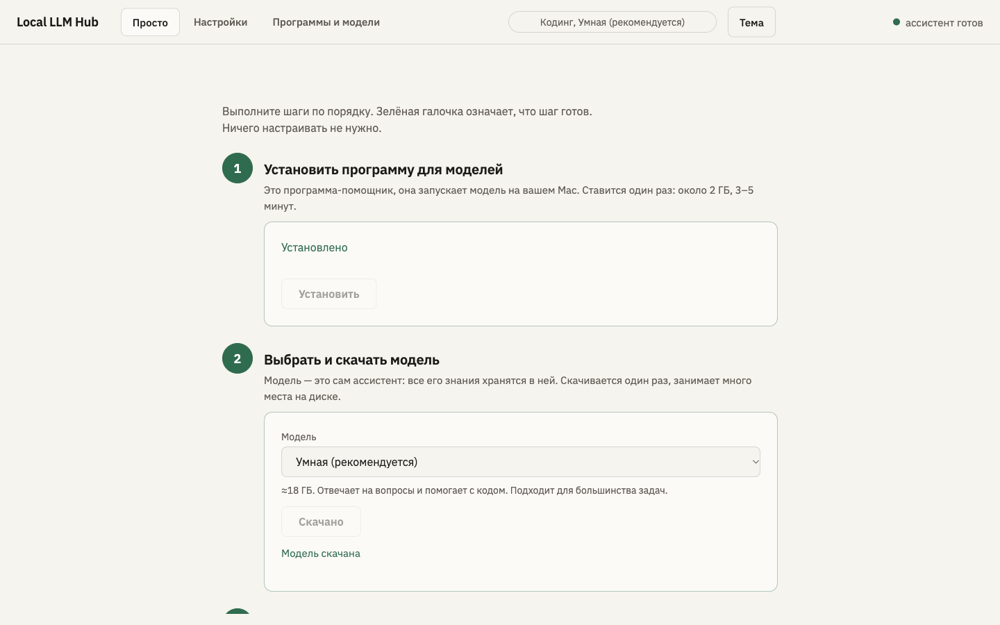

# Local LLM Hub

[](https://github.com/aa-blinov/local-llm-hub/actions/workflows/ci.yml)
[](https://github.com/aa-blinov/local-llm-hub/actions/workflows/house-style.yml)
[](LICENSE)

Веб-панель для запуска языковых моделей на Mac с Apple Silicon. Выберите модель и движок, запустите ассистента одной кнопкой, проверьте ответ и следите за памятью. Всё работает локально, без облака.



## Installation

**Requirements**

- Mac с Apple Silicon (M1 и новее). Проверено на macOS 26 и 48 ГБ памяти.
- Около 20 ГБ свободного места под одну модель.
- Для установки: Xcode Command Line Tools (установщик предложит их сам).

**Quick start**

1. Скачайте репозиторий и дважды щёлкните `install.command`.
2. Дождитесь окончания установки. Панель откроется по адресу http://127.0.0.1:8765.
3. Следуйте четырём шагам на экране: установить программу, скачать модель, запустить ассистента, задать вопрос.

**From the terminal**

```bash
./scripts/bootstrap.sh --engine mlx        # mlx, llamacpp или both
```

Установщик создаёт окружение, ставит пакеты, при необходимости собирает llama.cpp, настраивает автозапуск и открывает панель. Повторный запуск безопасен.

## What it does

- **Two engines.** MLX (`mlx_vlm.server`) for models in MLX format and llama.cpp (`llama-server`, Metal) for GGUF. The engine is chosen at installation and can be changed in the interface.
- **Memory check before start.** The panel estimates weights and KV cache for the chosen conversation length and compares them with available memory. It warns before the model is loaded.
- **Automatic restart.** If an engine crashes, it restarts itself, at most three times in ten minutes. Every event is written to a local history.
- **Model downloads** from Hugging Face in the background, with progress and resume after an interruption. Gated models are supported with a token.
- **Existing models.** Point the panel at a folder with models (an external drive, LM Studio) and it uses them without downloading again.
- **opencode integration.** A button writes a `local-hub` provider into the opencode configuration. Other providers are left untouched, and a backup is created first.
- **Settings.** Autostart at login, start screen, download folder, token, swap warning threshold.

Two views: **Просто** (four guided steps for a first run) and **Настройки** (state, memory, logs and parameters). Components are managed in **Программы и модели**.

## Development

```bash
uv venv --python 3.12 .venv
uv pip install --python .venv/bin/python -e '.[dev]'
.venv/bin/python -m llm_hub              # panel on http://127.0.0.1:8765
.venv/bin/python -m pytest tests         # tests, offline, no models required
```

Layout:

- `src/llm_hub/` — backend: configuration, engines, process supervisor, downloads, memory check, HTTP API.
- `src/llm_hub/static/` — interface: one HTML file and one script, no build step.
- `config/registry.json` — engines, models and presets.
- `scripts/` — installation, launchd agent, launcher.

Architecture is described in [`docs/architecture.md`](docs/architecture.md). Conventions and pitfalls for contributors and coding agents are in [`AGENTS.md`](AGENTS.md). To propose a change, see [`CONTRIBUTING.md`](CONTRIBUTING.md).

## Known limitations

- macOS only. Memory and process checks rely on macOS tools (`vm_stat`, `sysctl`).
- The memory estimate is approximate. Hybrid models are estimated by their full-attention layers; GGUF KV cache is not estimated.
- A model that is already loaded is not unloaded automatically when another one starts: stop the current one first.
- The setup has been tested on one machine. A clean install on another Mac is not verified yet.

## Security

Settings, including a Hugging Face token, are stored in `config/settings.json` with owner-only permissions and are excluded from git. Report vulnerabilities as described in [`SECURITY.md`](SECURITY.md).

## License

MIT. See [LICENSE](LICENSE). © Alexander Blinov.
